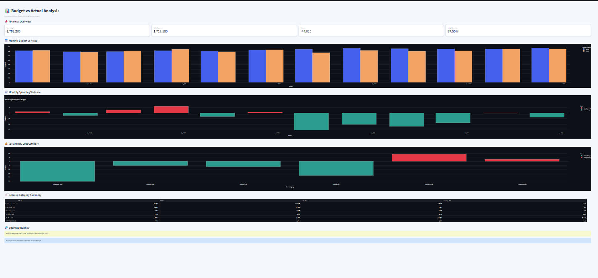

# 📊 Budget vs Actual Analysis

## 📌 Project Overview

This project analyzes budgeted and actual expenses over 12 months in 2023 to evaluate financial performance, identify spending variances, and support data-driven business decisions.

An interactive dashboard built with Python and Streamlit enables users to compare planned spending with actual expenses, explore cost categories, and identify potential overspending.

## 🎯 Project Objectives

- Compare budgeted expenses with actual spending.
- Monitor monthly budget execution.
- Identify cost categories exceeding their budgets.
- Analyze spending variances and variance percentages.
- Provide actionable insights for financial planning and cost control.

## 🛠️ Tools and Technologies

- **Python** — Data analysis and calculations
- **Pandas** — Data manipulation and aggregation
- **Plotly** — Interactive data visualization
- **Streamlit** — Interactive dashboard development
- **GitHub** — Version control and project hosting

## 📈 Key Financial Results

| Metric | Result |
|---|---:|
| Total Budget | 1,762,200 |
| Actual Expenses | 1,718,180 |
| Total Variance | -44,020 |
| Budget Execution Rate | 97.50% |
| Analysis Period | January–December 2023 |

*Interpretation: Overall spending was 44,020 below the planned budget.*

## 🔍 Key Findings

- Total actual expenses remained below the annual budget.
- Operational Costs exceeded their budget by 9,082.
- Maintenance Cost exceeded its budget by 2,487.
- Development, Marketing, Travelling, and Training Costs remained below their respective budgets.
- Monthly analysis revealed periods of both overspending and underspending.

## 💡 Business Recommendations

- Investigate the causes of overspending in Operational Costs and Maintenance Cost.
- Monitor monthly variances to identify unusual spending patterns early.
- Review budget assumptions and spending forecasts regularly.
- Maintain appropriate cost controls without compromising essential business activities.
- Use variance analysis to improve future budgeting and resource allocation.

## 🚀 Interactive Dashboard

Explore the live dashboard to filter months and cost categories, compare financial performance, and review spending variances.
# 📊 Budget vs Actual Analysis

## 📌 Project Overview

This project analyzes budgeted and actual expenses over 12 months in 2023 to evaluate financial performance, identify spending variances, and support data-driven business decisions.

An interactive dashboard built with Python and Streamlit enables users to compare planned spending with actual expenses, explore cost categories, and identify potential overspending.

## 🎯 Project Objectives

- Compare budgeted expenses with actual spending.
- Monitor monthly budget execution.
- Identify cost categories exceeding their budgets.
- Analyze spending variances and variance percentages.
- Provide actionable insights for financial planning and cost control.

## 🛠️ Tools and Technologies

- **Python** — Data analysis and calculations
- **Pandas** — Data manipulation and aggregation
- **Plotly** — Interactive data visualization
- **Streamlit** — Interactive dashboard development
- **GitHub** — Version control and project hosting

## 📈 Key Financial Results

| Metric | Result |
|---|---:|
| Total Budget | 1,762,200 |
| Actual Expenses | 1,718,180 |
| Total Variance | -44,020 |
| Budget Execution Rate | 97.50% |
| Analysis Period | January–December 2023 |

*Interpretation: Overall spending was 44,020 below the planned budget.*

## 🔍 Key Findings

- Total actual expenses remained below the annual budget.
- Operational Costs exceeded their budget by 9,082.
- Maintenance Cost exceeded its budget by 2,487.
- Development, Marketing, Travelling, and Training Costs remained below their respective budgets.
- Monthly analysis revealed periods of both overspending and underspending.

## 💡 Business Recommendations

- Investigate the causes of overspending in Operational Costs and Maintenance Cost.
- Monitor monthly variances to identify unusual spending patterns early.
- Review budget assumptions and spending forecasts regularly.
- Maintain appropriate cost controls without compromising essential business activities.
- Use variance analysis to improve future budgeting and resource allocation.
## 📸 Dashboard Preview




## 🚀 Interactive Dashboard

Explore the live dashboard to filter months and cost categories, compare financial performance, and review spending variances.

**Live Dashboard:** [Open the Budget vs Actual Analysis Dashboard](https://budget-vs-actual-analysis-bvkcg5ux3bsnme5wgej3rs.streamlit.app/)

> Replace the dashboard URL above with the dedicated Budget vs Actual Analysis Streamlit URL if it differs from your Retail Inventory dashboard.

## 📂 Repository Structure

```text
Budget-vs-Actual-Analysis/
├── budget_Vs_Actual.py
├── budget_vs_actual.csv
├── requirements.txt
└── README.md
```

## ▶️ Run the Project Locally

1. Clone the repository:

```bash
git clone https://github.com/lordleny-png/Budget-vs-Actual-Analysis.git
```

2. Open the project directory:

```bash
cd Budget-vs-Actual-Analysis
```

3. Install dependencies:

```bash
pip install -r requirements.txt
```

4. Launch the dashboard:

```bash
streamlit run budget_Vs_Actual.py
```

## 📊 Dataset

Source: [Financial Dataset — Expenses Budget vs Actual on Kaggle](https://www.kaggle.com/datasets/saharsyed/financial-dataset-expenses-budget-vs-actual)

The dataset contains monthly budget and actual expense records across six cost categories for 2023.

## ⚠️ Disclaimer

This project is intended for educational and portfolio purposes. The findings reflect the provided dataset and should not be interpreted as audited financial statements.

## 👤 Author
**Leny Napala**

Business Analytics | Data Analysis | Financial Performance Monitoring


**Live Dashboard:** [Open the Budget vs Actual Analysis Dashboard](https://budget-vs-actual-analysis-bvkcg5ux3bsnme5wgej3rs.streamlit.app/)

> Replace the dashboard URL above with the dedicated Budget vs Actual Analysis Streamlit URL if it differs from your Retail Inventory dashboard.

## 📂 Repository Structure

```text
Budget-vs-Actual-Analysis/
├── budget_Vs_Actual.py
├── budget_vs_actual.csv
├── requirements.txt
└── README.md
```

## ▶️ Run the Project Locally

1. Clone the repository:

```bash
git clone https://github.com/lordleny-png/Budget-vs-Actual-Analysis.git
```

2. Open the project directory:

```bash
cd Budget-vs-Actual-Analysis
```

3. Install dependencies:

```bash
pip install -r requirements.txt
```

4. Launch the dashboard:

```bash
streamlit run budget_Vs_Actual.py
```

## 📊 Dataset

Source: [Financial Dataset — Expenses Budget vs Actual on Kaggle](https://www.kaggle.com/datasets/saharsyed/financial-dataset-expenses-budget-vs-actual)

The dataset contains monthly budget and actual expense records across six cost categories for 2023.

## ⚠️ Disclaimer

This project is intended for educational and portfolio purposes. The findings reflect the provided dataset and should not be interpreted as audited financial statements.

## 👤 Author
**Leny Napala**

Business Analytics | Data Analysis | Financial Performance Monitoring
